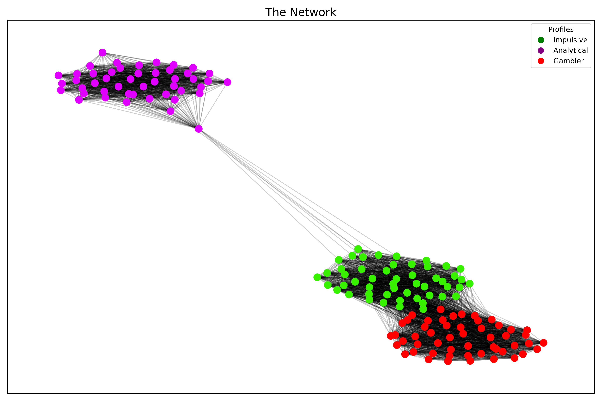
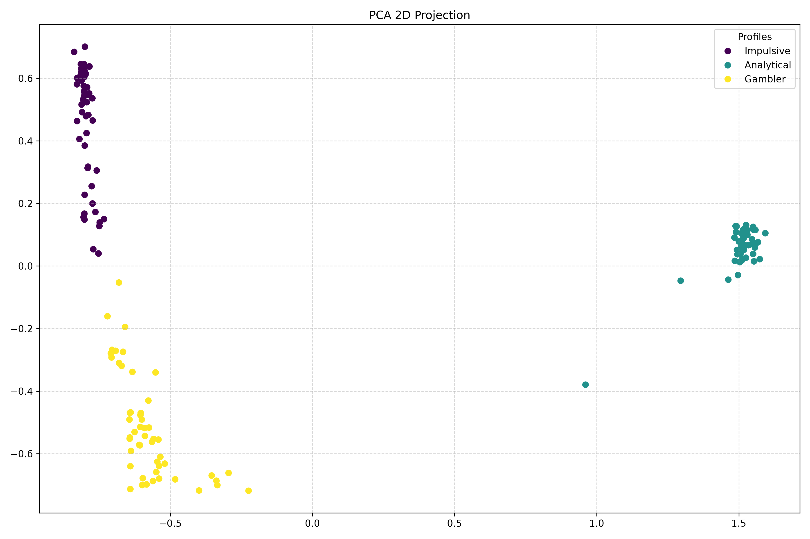
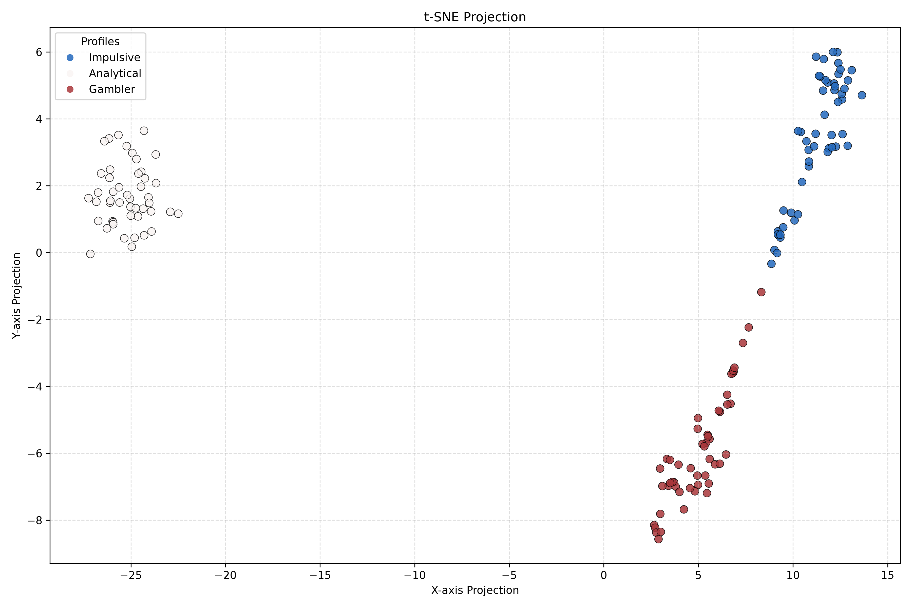

# Behavioral Homophily Network: Development Cycle-Phase 01

## Cycle 1: Baseline Topology and Wiring

* **Setup**:
  * Generated a synthetic network of `150` nodes using three distinct psychological profiles.
  * Links are created with the help of `cosine similarity`[from `sklearn.metrics.pairwise`]
* **Parameters Used**:
  * Profiles:

    ```py
    # Features: [Risk Tolerance, Observation Index, Impulsivity]
    0: [0.7, 0.2, 0.95],  # Impulsive
    1: [0.47, 0.9, 0.32], # Analytical
    2: [0.9, 0.87, 0.5]   # Gambler
    ```

  * `similarity_threshold = 0.90`
  * `layout = nx.spring_layout(G, seed=42)`
* **Observations**:
  * **Outcome**: The graph did not form a close clustered network as per initial assumption.
  * **Insight**: The `Analytical` and `Gambler` profiles formed denser links.

  ---

  ### Cycle 2: Restructuring the Network

  * **Modifications**: Updated metrics for the different psychological labels.
  * **Parameters Used**:
    * Profiles:

    ```py
      # Features: [Risk Tolerance, Observation Index, Impulsivity]
      0: [0.87, 0.12, 0.95], # Impulsive: Extreme Risk Tolerance and Impulsiveness, Low observation
      1: [0.2, 0.97, 0.20],  # Analytical: Extreme Observation, Lower Risk Tolerance and Impulsiveness
      2: [0.73, 0.59, 0.65]  # Gambler: High Risk, Moderate Obseration(Acts as a middle ground)

    ```

    * `similarity_threshold = 0.915`(+0.015) for lesser links based on metrics.
  * **Outcome**: Obtained a more realistic and messier network.
  * **Insights**: `Impulsive` and `Gambler` profiles have stronger links when compared to `Analytical` one.

  
  
  ---

### Cycle 3: Embedding

* **Setup**:
  * **Node2Vec**: Used to flatten the graph into a `150 x 64` matrix.
* **Parameters Used**:
  * `dimensions=64`
  * `walk_length=30`
  * `num_walks=200`
  * `window=10`
* **Visualization**:
  * **PCA**:
    * **Parameters Used**:
      * `n_components=2`
      * `random_state=42`
    * **Inference**:
      * **Analytical**: Pushed entirely to the far left of the X-axis. This separation confirms `Analytical` profiles form an 'Echo-Chamber'.
      * **Impulsive & Gambler**: Occupy the same X-axis territory on the right. PCA algorithm was forced to separate them based on Y-axis due to their strong links to slice them apart, since `Node2Vec` maps based on network topology.
      * **Bridge**: Some of the `Analytical` profiles seem to generate some kind of links among the other dominant profiles.
  * **t-SNE**:
    * **Parameters Used**:
      * `n_components=2`
      * `perplexity=30`
      * `max_iter=1000`
      * `random_state=42`
    * **Inference**:
      * **Analytical**: Forms a highly isolated cluster spaced far apart from `Impulsive` and `Gambler`. Zero cross profile links.
      * **Impulsive & Gambler**: `t-SNE` algorithm has successfully segregated `Impulsive` and `Gambler` profiles into distinct clusters when compared to **PCA**.
      * **Bridge**: The `Gambler` and `Impulsive` profiles have weak ties with each other as **t-SNE** algorithm have placed these clusters in proximity.



