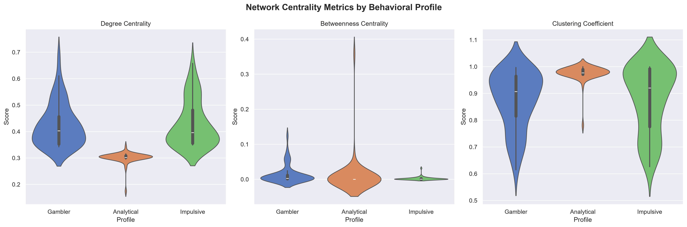

# Behavioral Homophily Network

## Development Cycle-Phase 2: Network Analytics and Centrality Metrics

### Cycle 1

* **Setup**: Visualization of Network Centrality Metrics using **Violin Plots**.
* **Parameters**: `Degree Centrality`, `Betweenness`, and `Clustering Coefficient`.
* **Inference**:
  * **Degree Centrality**: `Gambler` and `Impulsive` nodes act as highly connected social hubs with dozens of connections. The `Analytical` nodes strictly limit their interactions, maintaining very few, isolated connections.
  * **Betweenness**: The vast majority of nodes hold zero bridging power. However, the rare mathematical outliers in the `Analytical` profile act as the critical **weak ties**, serving as the sole structural gatekeepers between distinct communities.
  * **Clustering Coefficient**: The `Analytical` cluster completely dominates this metric, heavily concentrating at the maximum score to mathematically prove they form a perfectly **closed loop** or **echo chamber**.

